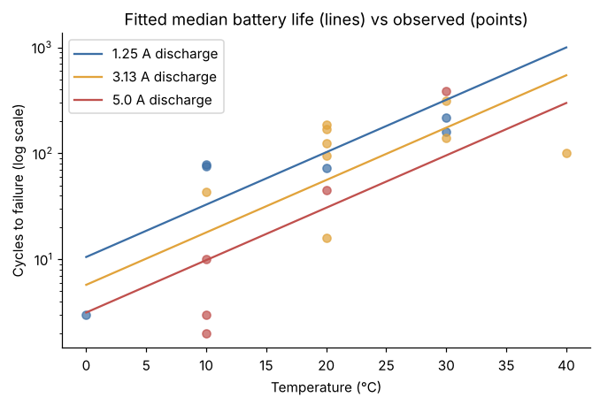

# What Drives Silver-Zinc Battery Life? A Multiple Regression Analysis

A regression analysis of how operating conditions affect the lifespan of silver-zinc batteries developed for satellites, using Python (`statsmodels`).



## Question

Twenty batteries were tested under different combinations of charge rate, discharge rate, depth of discharge, temperature and end-of-charge voltage, and the number of cycles until each one failed was recorded. **Which conditions predict battery life, and how well can we forecast it?**

## Key findings

- **Temperature is the dominant factor.** Each 1 °C increase is associated with about **12% more cycles** to failure (95% CI: +6.5% to +18%) within the tested 0–40 °C range.
- **Higher discharge rates probably shorten battery life** (about −27% cycles per amp), but the evidence is borderline (p ≈ 0.08) and needs more data to confirm.
- Charge rate, depth of discharge, end-of-charge voltage and all two-way interactions showed **no detectable effect** with n = 20.
- The final model, `log10(cycles) ~ discharge rate + temperature`, had the **lowest leave-one-out cross-validation error and lowest BIC** of all 31 main-effects models. It beat a 6-term interaction model that had a higher R² but predicted new data worse.
- For the requested conditions (4.5 A discharge, 25 °C), the forecast median life is about **64 cycles**. A single battery could plausibly last anywhere from 6 to 677 cycles (95% prediction interval), which shows how much batteries vary.

## Methods

- **Response transformation:** Box–Cox analysis and Breusch–Pagan tests showed that raw cycle counts violate the constant-variance assumption. A log10 transform fixes that and makes coefficients readable as percentage changes.
- **Multicollinearity:** variance inflation factors (all ≈ 1.0–1.15).
- **Model selection:** all-subsets regression compared on adjusted R², AIC, BIC and leave-one-out cross-validation, with nested F-tests between candidates.
- **Interactions:** each two-way interaction tested on its own, with both main effects kept in the model (hierarchy principle).
- **Diagnostics:** residual plots, Shapiro–Wilk, Breusch–Pagan, leverage, studentized residuals, Cook's distance, DFFITS and a sensitivity refit without influential points.
- **Forecasting:** confidence and prediction intervals on the log scale, back-transformed to cycles (as medians), with a check that the new point isn't an extrapolation.

## Revisions to the original project

This started as a course project done in Minitab and Excel. I rebuilt it in Python and corrected several methods: VIF instead of Durbin–Watson for multicollinearity, cross-validation instead of raw R² for model selection, hierarchical testing of interactions, and a sensitivity analysis instead of deleting outliers. The corrected analysis reaches a simpler and better-supported conclusion. The full comparison is at the end of the notebook.

## Repository structure

```
├── analysis.ipynb          # Full analysis, with outputs
├── data/
│   └── battery_cycles.csv  # 20 test batteries, 5 predictors + cycles to failure
├── figures/                # Key figures exported from the notebook
├── build_notebook.py       # Script that generates analysis.ipynb
└── requirements.txt
```

## Reproduce

```bash
pip install -r requirements.txt
jupyter notebook analysis.ipynb
```

## Data

Cycles-to-failure measurements from silver-zinc battery development tests for satellite applications, as provided for the course. Variables: charge rate (A), discharge rate (A), depth of discharge (% of rated ampere-hours), temperature (°C), end-of-charge voltage (V) and cycles to failure.
